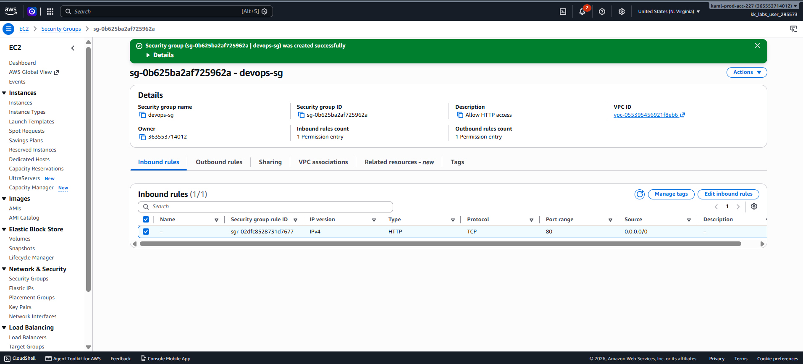
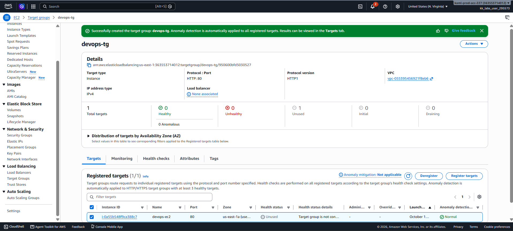
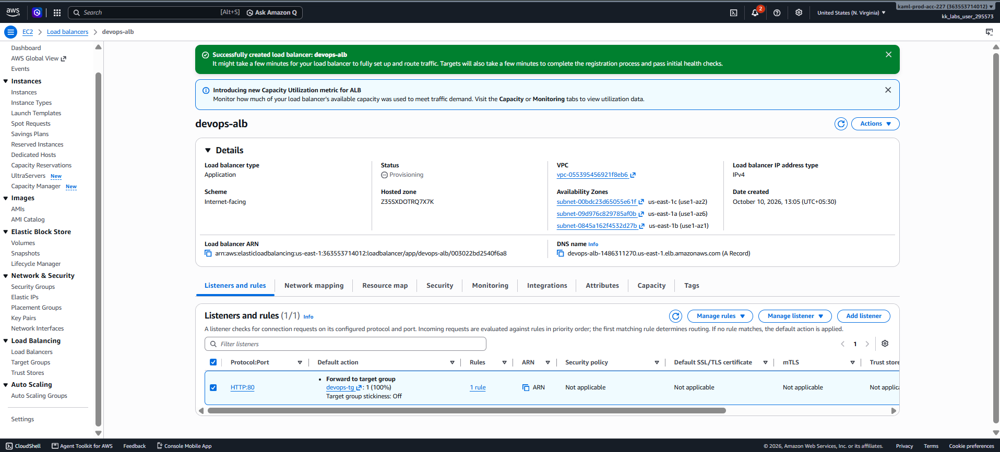
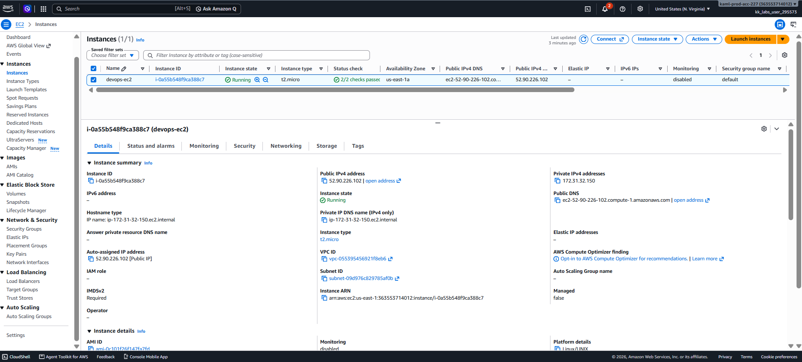

# Day 24 — Application Load Balancer Setup for EC2

## 🎯 Objective
Set up an Application Load Balancer (`devops-alb`) in front of the `devops-ec2` instance running Nginx. Create a target group (`devops-tg`) and security group (`devops-sg`) allowing HTTP port 80 access, and route ALB traffic to port 80 on the EC2 instance.

## 🧭 Steps Taken
1. Created security group `devops-sg` with inbound HTTP (port 80) from `0.0.0.0/0`.
2. Created target group `devops-tg` (HTTP, port 80, instance target type).
3. Registered `devops-ec2` with the target group.
4. Created Application Load Balancer `devops-alb` (Internet-facing, IPv4).
5. Selected subnets across 3 Availability Zones (`us-east-1a`, `us-east-1b`, `us-east-1c`).
6. Attached `devops-sg` to the ALB.
7. Configured HTTP listener on port 80 forwarding to `devops-tg`.
8. Verified the EC2 instance's default security group allows HTTP traffic.
9. Confirmed the ALB status is **Active** and the listener forwards to `devops-tg`.

## ☁️ AWS Services Used
- **EC2** (Load Balancers, Target Groups, Security Groups, Instances)

## 💡 Key Learnings
- ALBs work at **Layer 7** (Application Layer) and can route based on URL paths, hosts, and headers.
- A **target group** is the logical grouping of backend resources; the ALB sends traffic to the TG, which routes to healthy targets.
- The ALB requires subnets in **at least two Availability Zones** for high availability.
- **Security group nesting** — allowing traffic from the ALB's SG to the EC2's SG — is a best practice for isolating backend servers.
- Health checks determine which targets receive traffic; unhealthy targets are automatically removed from rotation.
- The ALB's DNS name is the public entry point for users; the EC2 instance's public IP is never exposed directly.

## 🧾 Configuration Summary

| Component | Name | Details |
|-----------|------|---------|
| Security Group | `devops-sg` | HTTP port 80 open to 0.0.0.0/0 |
| Target Group | `devops-tg` | HTTP:80, Instance, registered `devops-ec2` |
| Load Balancer | `devops-alb` | Internet-facing, Application, 3 AZs |
| Listener | HTTP:80 | Forwards to `devops-tg` |
| EC2 Instance | `devops-ec2` | t2.micro, Running, Nginx |

## 🖼️ Screenshots

### Security Group `devops-sg`

### Target Group `devops-tg`

### Load Balancer `devops-alb`

### EC2 Instance `devops-ec2`

## 🔗 Reference
- Task provided by: [KodeKloud 100 Days of Cloud](https://kodekloud.com/100-days-of-cloud)
