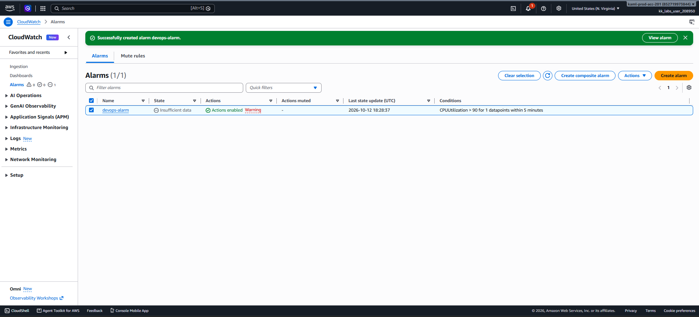

# Day 25 — Create a CloudWatch Alarm for CPU Utilization

## 🎯 Objective
Launch an EC2 instance (`devops-ec2`) and create a CloudWatch alarm (`devops-alarm`) that triggers when CPU utilization exceeds 90% for one consecutive 5-minute period, sending a notification to the SNS topic `devops-sns-topic`.

## 🧭 Steps Taken
1. Launched an Ubuntu `t2.micro` EC2 instance named `devops-ec2` in `us-east-1`.
2. Waited for the instance to reach `Running` state with `2/2` checks passed.
3. Navigated to **CloudWatch → Alarms** and clicked **Create alarm**.
4. Selected the **EC2 Per-Instance Metrics** for `devops-ec2` with the **CPUUtilization** metric.
5. Configured the alarm:
   - **Statistic**: Average
   - **Period**: 5 minutes
   - **Threshold**: >= 90%
   - **Evaluation**: 1 consecutive period
6. Set the alarm action to notify the SNS topic `devops-sns-topic`.
7. Named the alarm `devops-alarm` and created it.
8. Verified the alarm appears in the CloudWatch Alarms list.

## ☁️ AWS Services Used
- **EC2** (Instance)
- **CloudWatch** (Alarms, Metrics)
- **SNS** (Notifications)

## 💡 Key Learnings
- CloudWatch alarms evaluate a metric against a threshold over one or more periods.
- **Average** is the most common statistic for CPU utilization alarms, as it smooths out spikes.
- The **Datapoints to alarm** setting (1 out of 1) means the alarm triggers if a single 5-minute period breaches the threshold.
- **Alarm states**: `OK` (metric normal), `ALARM` (threshold breached), `INSUFFICIENT_DATA` (not enough data yet).
- SNS notifications require the topic to exist in the same region as the alarm.
- Alarms are **stateless** — they only change state when the metric breaches the threshold.

## 🖼️ Screenshot

### CloudWatch Alarm Created

## 🔗 Reference
- Task provided by: [KodeKloud 100 Days of Cloud](https://kodekloud.com/100-days-of-cloud)
