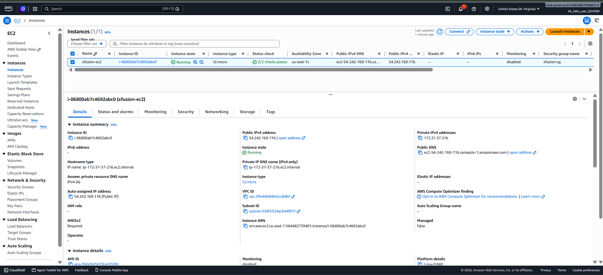

# Day 26 — Configure an EC2 Instance as an Nginx Web Server

## 🎯 Objective
Launch an Ubuntu EC2 instance (`xfusion-ec2`) and automate the installation of Nginx using a User Data script, ensuring the web server is accessible on port 80.

## 🧭 Steps Taken
1. Launched an Ubuntu `t2.micro` instance named `xfusion-ec2`.
2. In the **Advanced details** section, provided a User Data script to:
   - Update package lists (`apt-get update`).
   - Install Nginx (`apt-get install nginx`).
   - Start the Nginx service (`systemctl start nginx`).
   - Enable Nginx on boot (`systemctl enable nginx`).
3. Created a Security Group (`xfusion-sg`) with an inbound rule allowing **HTTP (Port 80)** from `0.0.0.0/0`.
4. Waited for the instance to pass its status checks.
5. Verified the web server by visiting the instance's public IP — the Nginx welcome page loaded successfully.

## ☁️ AWS Services Used
- **EC2** (Instance, User Data, Security Groups)

## 💡 Key Learnings
- **User Data** scripts run as the **root user** on the first boot only — no `sudo` is required inside the script [citation:2][citation:10].
- The script **must start** with `#!/bin/bash` to be interpreted correctly by cloud-init.
- **Security Groups are stateful**: allowing inbound port 80 is sufficient for responses to flow back out; no separate outbound rule is needed for the web traffic itself [citation:4].
- **Bootstrapping** (using User Data) is essential for creating reproducible, automated infrastructure without manual SSH configuration.

## 🖼️ Screenshot

### Nginx Welcome Page

## 🔗 Reference
- Task provided by: [KodeKloud 100 Days of Cloud](https://kodekloud.com/100-days-of-cloud)
