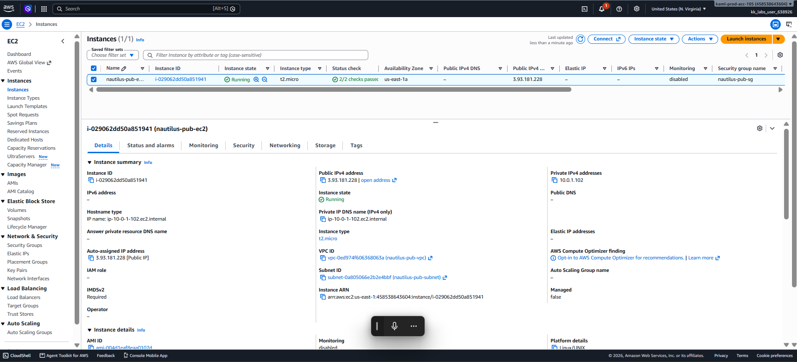
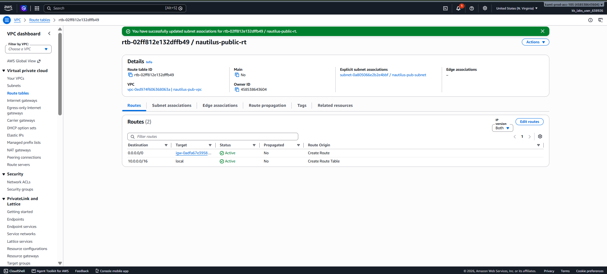

# Day 27 — Configure a Public VPC with an EC2 Instance for Internet Access

## 🎯 Objective
Create a public VPC (`nautilus-pub-vpc`) with a public subnet (`nautilus-pub-subnet`) that auto-assigns public IPs, and launch an EC2 instance (`nautilus-pub-ec2`, t2.micro) accessible via SSH from the internet.

## 🧭 Steps Taken
1. Created VPC `nautilus-pub-vpc` with CIDR `10.0.0.0/16`.
2. Created subnet `nautilus-pub-subnet` (`10.0.1.0/24`) in `us-east-1a`.
3. Enabled **auto-assign public IPv4 address** on the subnet.
4. Created Internet Gateway `nautilus-igw` and attached it to the VPC.
5. Created route table `nautilus-public-rt` with route `0.0.0.0/0` → Internet Gateway.
6. Associated the route table with `nautilus-pub-subnet`.
7. Launched EC2 instance `nautilus-pub-ec2` in the new VPC/subnet with auto-assign public IP enabled.
8. Created security group `nautilus-pub-sg` allowing SSH (port 22) from `0.0.0.0/0`.
9. Verified the instance received a public IP (`3.93.181.228`) and is in `Running` state.

## ☁️ AWS Services Used
- **VPC** (VPC, Subnets, Internet Gateway, Route Tables)
- **EC2** (Instances, Security Groups)

## 💡 Key Learnings
- A **public subnet** requires three things working together:
  1. Auto-assign public IP enabled on the subnet.
  2. An Internet Gateway attached to the VPC.
  3. A route table with `0.0.0.0/0` → Internet Gateway, associated with the subnet.
- The **Internet Gateway is a VPC-level resource** — it must be attached to the VPC, not the subnet.
- **Route table association** is what actually makes a subnet "public." Without the association, the subnet uses the main route table and stays private.
- **Security groups** are the final layer of access control — even with correct routing, SSH must be explicitly allowed.
- Best practice: **allow SSH from a specific IP range**, not `0.0.0.0/0`, in production.

## 🧾 Resources Created

| Resource | Name | ID |
|----------|------|-----|
| VPC | `nautilus-pub-vpc` | `vpc-0ed974f606368063a` |
| Subnet | `nautilus-pub-subnet` | `subnet-0a805066e2b2e4bbf` |
| Internet Gateway | `nautilus-igw` | `igw-0adfa67e39582ffea` |
| Route Table | `nautilus-public-rt` | `rtb-02ff812e132dffb49` |
| EC2 Instance | `nautilus-pub-ec2` | `i-029062dd50a851941` |
| Security Group | `nautilus-pub-sg` | — |

## 🖼️ Screenshots

### EC2 Instance — Running with Public IP

### Route Table — Public Route to Internet Gateway

## 🔗 Reference
- Task provided by: [KodeKloud 100 Days of Cloud](https://kodekloud.com/100-days-of-cloud)
