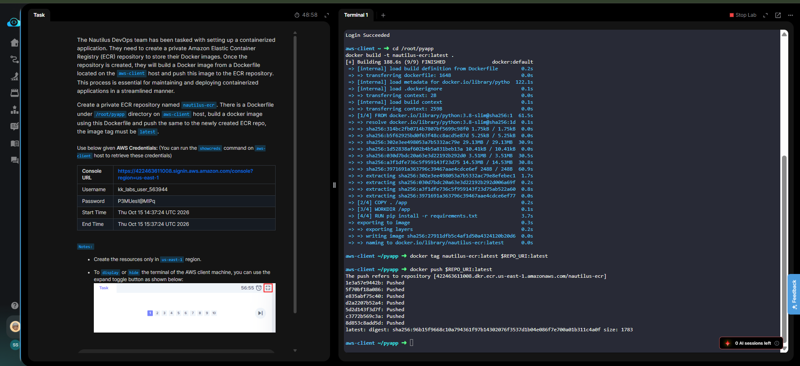

# Day 28 — Create a Private ECR Repository and Push a Docker Image

## 🎯 Objective
Create a private Amazon ECR repository named `nautilus-ecr` and push a Docker image built from a Dockerfile in `/root/pyapp` with the tag `latest`.

## 🧭 Steps Taken
1. Created the private ECR repository using `aws ecr create-repository`.
2. Retrieved the repository URI for tagging.
3. Authenticated Docker with ECR using `aws ecr get-login-password`.
4. Navigated to `/root/pyapp` and built the Docker image with `docker build`.
5. Tagged the local image with the full ECR repository URI.
6. Pushed the image to the `nautilus-ecr` repository.

## ☁️ AWS Services Used
- **ECR** (Elastic Container Registry)

## 💡 Key Learnings
- The **repository URI** is the address Docker uses to find your registry. The format is `<account_id>.dkr.ecr.<region>.amazonaws.com/<repo_name>`[citation:8].
- **Authentication tokens** from `get-login-password` are temporary (valid for 12 hours), which is why they are piped directly into `docker login`[citation:9].
- The **`docker tag`** step is not cosmetic—it tells Docker which registry the image belongs to. Without it, `docker push` defaults to Docker Hub and fails[citation:14].
- ECR is **region-specific**, so the repository and push commands must use the same region[citation:9].

## 🧾 Commands Used

```bash
# Create the ECR repository
aws ecr create-repository --repository-name nautilus-ecr --region us-east-1

# Get the repository URI
REPO_URI=$(aws ecr describe-repositories --repository-names nautilus-ecr --query 'repositories[0].repositoryUri' --output text --region us-east-1)

# Authenticate Docker to ECR
aws ecr get-login-password --region us-east-1 | docker login --username AWS --password-stdin $REPO_URI

# Build the Docker image
cd /root/pyapp
docker build -t nautilus-ecr:latest .

# Tag the image for ECR
docker tag nautilus-ecr:latest $REPO_URI:latest

# Push the image
docker push $REPO_URI:latest
```

## 🖼️ Screenshot

### ECR Image Pushed


## 🔗 Reference
- Task provided by: [KodeKloud 100 Days of Cloud](https://kodekloud.com/100-days-of-cloud)
