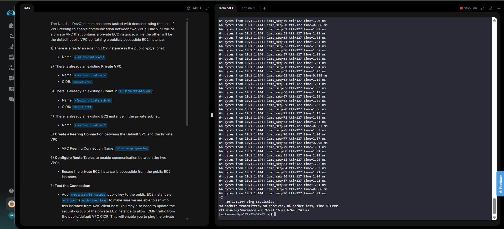

# Day 29 — VPC Peering and Cross-VPC Connectivity

## 🎯 Objective
Create a VPC Peering connection (`xfusion-vpc-peering`) between the Default VPC and `xfusion-private-vpc`, configure route tables on both sides, and test connectivity by pinging a private EC2 instance from a public EC2 instance.

## 🧭 Steps Taken
1. Created a VPC Peering connection between the Default VPC and `xfusion-private-vpc`, then accepted it.
2. Added a route in the Default VPC's route table: `10.1.0.0/16` → `xfusion-vpc-peering`.
3. Added a route in the Private VPC's route table: `172.31.0.0/16` → `xfusion-vpc-peering`.
4. Updated the private EC2 instance's security group to allow ICMP (ping) from the Default VPC CIDR.
5. Attached an Elastic IP to the public instance to ensure a static public IP.
6. Added the `aws-client` public key to `xfusion-public-ec2`'s `authorized_keys`.
7. SSH'd into the public instance and successfully pinged the private instance's private IP.

## 🔧 Troubleshooting Note (Important)
The public EC2 instance initially rejected SSH keys (`Permission denied`). To resolve this, I used the **EBS Volume Recovery Method**:
- Stopped the instance and detached its root volume.
- Launched a temporary helper instance.
- Attached the volume to the helper, mounted it (`/dev/xvdf1`), and manually added the `id_rsa.pub` key to `/home/ec2-user/.ssh/authorized_keys`.
- Reattached the volume to the original instance and started it.

## ☁️ AWS Services Used
- **VPC** (Peering Connections, Route Tables)
- **EC2** (Instances, Security Groups, Elastic IPs, EBS Volumes)

## 💡 Key Learnings
- **VPC Peering** is not transitive; route tables must be updated on both sides.
- **Security groups** must explicitly allow ICMP traffic from the peer VPC's CIDR.
- **EBS Volume Recovery** is a powerful last-resort technique to regain access to an EC2 instance when SSH keys are lost or rejected.
- **Elastic IPs** guarantee a static public IP, which is required by automated graders.

## 🖼️ Screenshot

## 🔗 Reference
- Task provided by: [KodeKloud 100 Days of Cloud](https://kodekloud.com/100-days-of-cloud)
