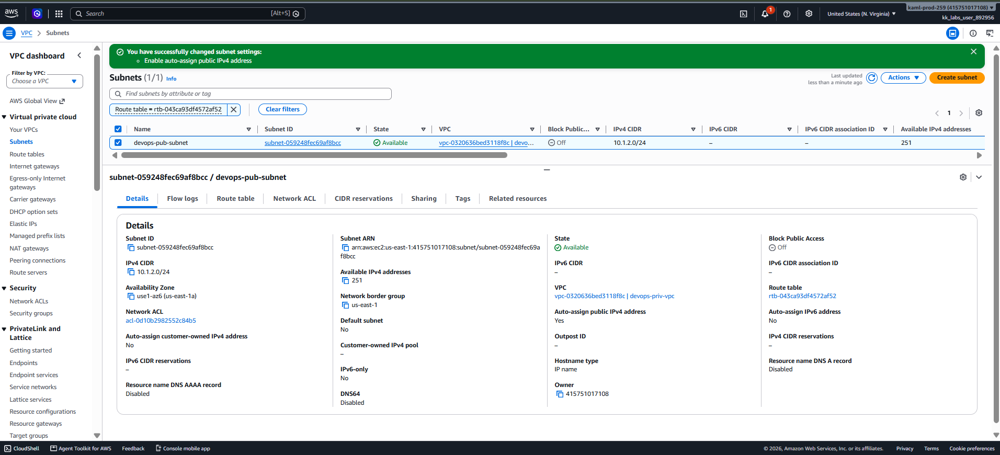
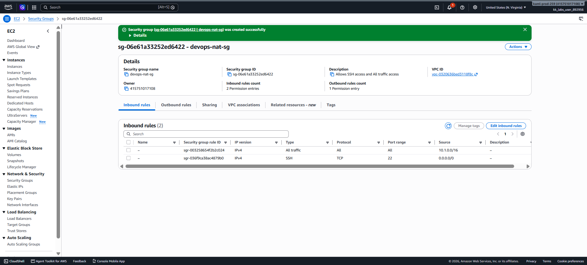
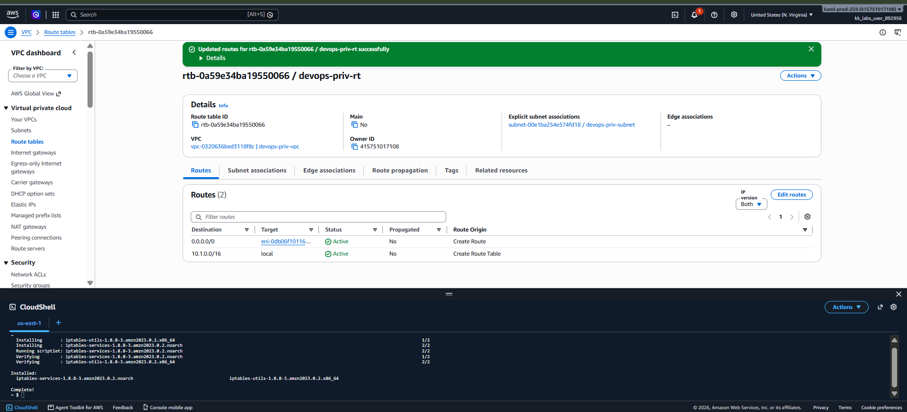
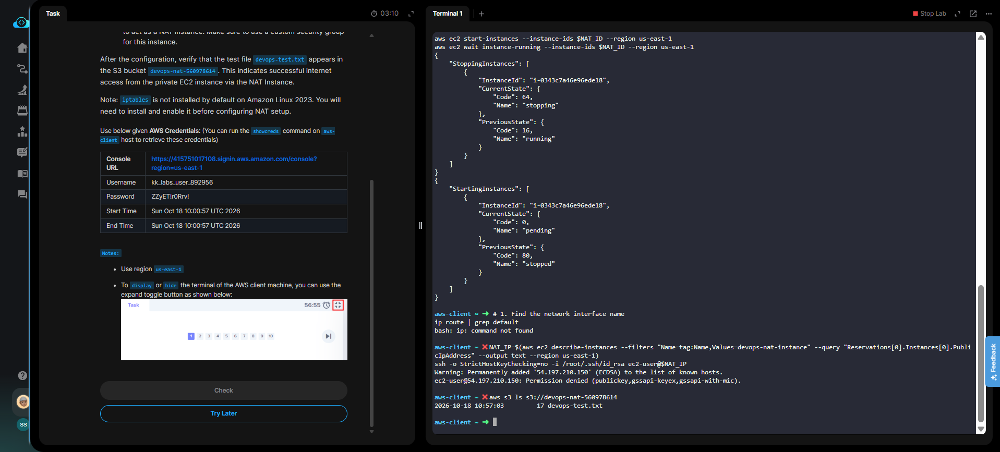

# Day 30 — Configure a NAT Instance for Private Subnet Internet Access

## 🎯 Objective
Enable internet access for a private EC2 instance (`devops-priv-ec2`) by configuring a NAT Instance in a new public subnet (`devops-pub-subnet`). The private instance uses a cron job to upload `devops-test.txt` to the S3 bucket `devops-nat-560978614`.

## 🧭 Steps Taken
1. Created a new public subnet `devops-pub-subnet` (`10.1.2.0/24`) in `devops-priv-vpc`.
2. Enabled **Auto-assign Public IPv4** on the subnet.
3. Associated the public subnet with a route table pointing `0.0.0.0/0` to the Internet Gateway.
4. Created a custom security group `devops-nat-sg` allowing all traffic from the VPC CIDR (`10.1.0.0/16`).
5. Launched an Amazon Linux 2023 `t2.micro` instance named `devops-nat-instance`.
6. Disabled **Source/Destination Check** on the NAT instance.
7. Connected via EC2 Instance Connect (browser terminal).
8. Installed `iptables-services`, enabled IP forwarding, and configured MASQUERADE.
9. Updated the private subnet route table to point `0.0.0.0/0` to the NAT instance.
10. Verified `devops-test.txt` appeared in the S3 bucket.

## ☁️ AWS Services Used
- **VPC** (Subnets, Route Tables, Internet Gateway)
- **EC2** (Instances, Security Groups, EC2 Instance Connect)
- **S3** (Target Bucket for upload test)

## 💡 Key Learnings
- **NAT Instance vs NAT Gateway**: NAT Instances are cheaper but require manual configuration (iptables, IP forwarding).
- **Source/Destination Check** must be disabled on the NAT instance, or it will drop forwarded packets.
- **Amazon Linux 2023** does not include `iptables` by default — you must `dnf install iptables-services`.
- **EC2 Instance Connect** is a lifesaver when local SSH keys fail. It injects a temporary key via the AWS backend.
- The private subnet's route table must point to the **NAT Instance ID** (not a gateway).
- **MASQUERADE** is the iptables rule that rewrites the source IP of outgoing packets to the NAT instance's public IP.

## 🛠️ Troubleshooting: How I Solved the SSH Issues

During this task, the standard SSH connection to `devops-nat-instance` failed with `Permission denied (publickey)`. The `aws-client` host did not have the correct private key, and User Data key injection failed.

**The Solution:**
1. **Used EC2 Instance Connect**: From the AWS Console, I selected the NAT instance and clicked **Connect → EC2 Instance Connect**. This bypasses local SSH keys entirely.
2. **Configured iptables inside the browser terminal**:
   ```bash
   sudo dnf install -y iptables-services
   sudo systemctl enable iptables
   sudo systemctl start iptables

   echo "net.ipv4.ip_forward = 1" | sudo tee /etc/sysctl.d/custom-ip-forwarding.conf
   sudo sysctl -p /etc/sysctl.d/custom-ip-forwarding.conf

   # Find interface name
   ip route | grep default
   
   # Apply MASQUERADE (interface was ens5)
   sudo /sbin/iptables -t nat -A POSTROUTING -o ens5 -j MASQUERADE
   sudo /sbin/iptables -F FORWARD
   sudo service iptables save
   ```
3. **Verified from `aws-client`** using `aws s3 ls s3://devops-nat-560978614`.

## 🧾 Commands Used

```bash
# Find the network interface on the NAT instance
ip route | grep default

# Configure iptables for NAT
sudo /sbin/iptables -t nat -A POSTROUTING -o ens5 -j MASQUERADE
sudo /sbin/iptables -F FORWARD
sudo service iptables save

# Verify S3 upload
aws s3 ls s3://devops-nat-560978614
```

## 🖼️ Screenshots

### 1. Public Subnet Configuration (Auto-assign IP)


### 2. Custom Security Group for NAT Instance


### 3. NAT Instance Configuration (iptables)


### 4. Success: Test File Uploaded to S3



## 🔗 Reference
- Task provided by: [KodeKloud 100 Days of Cloud](https://kodekloud.com/100-days-of-cloud)
