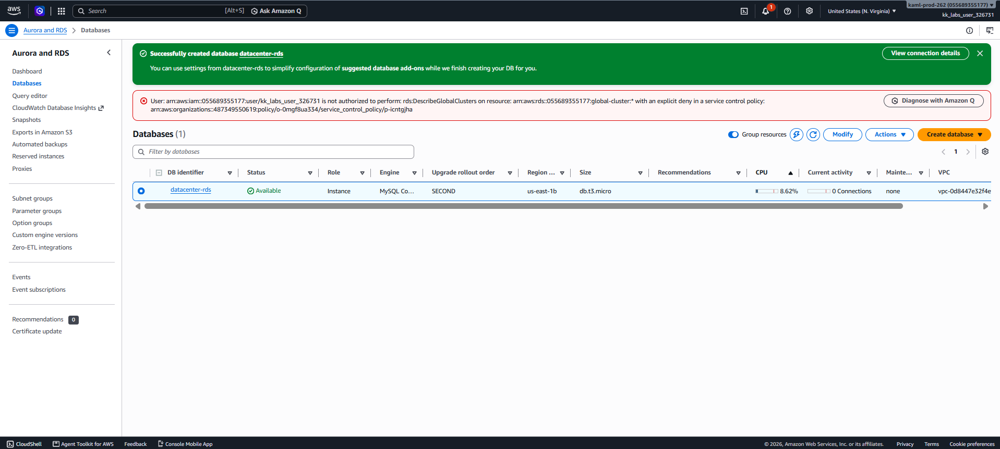

# Day 31 — Provision a Private RDS Instance (MySQL)

## 🎯 Objective
Create a private RDS instance named `datacenter-rds` using the Free tier template, MySQL 8.4.8 engine, `db.t3.micro` instance type, 20 GiB gp2 storage, and storage autoscaling enabled with a 22 GiB threshold.

## 🧭 Steps Taken
1. Navigated to the Amazon RDS Console and clicked **Create database**.
2. Selected **Full configuration** (Standard create) as the creation method.
3. Configured the engine: **MySQL** version **8.4.x**.
4. Selected the **Free tier** template.
5. Set the **DB instance identifier** to `datacenter-rds`.
6. Configured the instance class as **`db.t3.micro`**.
7. Set the storage type to **General Purpose SSD (gp2)** with **20 GiB** allocated storage.
8. Enabled **Storage autoscaling** and set the maximum threshold to **22 GiB**.
9. Ensured **Public access** was set to **No** (private instance).
10. Clicked **Create database** and waited until the status changed to **Available**.

## ☁️ AWS Services Used
- **RDS** (Relational Database Service)

## 💡 Key Learnings
- **Full configuration** (Standard create) is required when you need to specify exact storage, version, and autoscaling settings (Easy create does not allow this).
- **Storage autoscaling** helps prevent running out of disk space by automatically increasing capacity when needed, up to a defined maximum.
- The **Free tier** template automatically applies settings like Single-AZ deployment and disables features like Performance Insights to keep costs low.
- **Private access** (Public access = No) is a security best practice for databases, ensuring they cannot be reached from the internet.

## 🖼️ Screenshot

### RDS Instance Available

## 🔗 Reference
- Task provided by: [KodeKloud 100 Days of Cloud](https://kodekloud.com/100-days-of-cloud)
