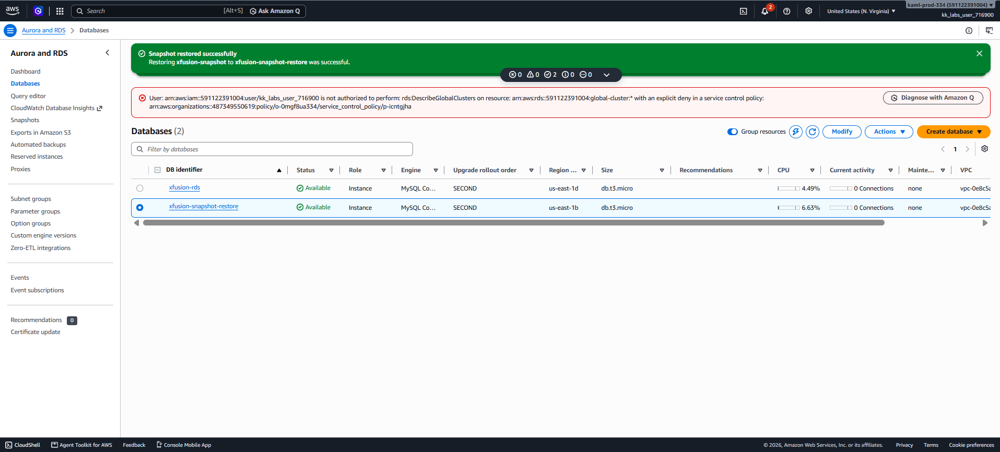

# Day 32 — RDS Snapshot and Restore

## 🎯 Objective
Take a snapshot of the `xfusion-rds` instance (`xfusion-snapshot`) and restore it to a new RDS instance (`xfusion-snapshot-restore`) with a `db.t3.micro` instance class.

## 🧭 Steps Taken
1. Opened the RDS Console and waited for `xfusion-rds` to reach the **Available** state.
2. Selected the instance and used **Actions → Take snapshot** to create `xfusion-snapshot`.
3. Waited for the snapshot to reach the **Available** state.
4. Selected the snapshot and used **Actions → Restore snapshot**.
5. Configured the new instance identifier as `xfusion-snapshot-restore` and the instance class as `db.t3.micro`.
6. Clicked **Restore DB instance** and waited for the restored instance to become **Available**.

## ☁️ AWS Services Used
- **RDS** (DB Instances, Snapshots)

## 💡 Key Learnings
- **Manual snapshots** are point-in-time backups that persist until explicitly deleted, unlike automated backups which expire based on retention settings.
- Restoring from a snapshot creates a **new DB instance** — you cannot restore over an existing instance [citation:3][citation:9].
- The restored instance **inherits** the engine version and many settings from the snapshot, but you can modify the instance class during restore.
- Both the source instance and the snapshot must be in **Available** state before you can proceed with restore operations.

## 🖼️ Screenshot

### RDS Restored Instance Available

## 🔗 Reference
- Task provided by: [KodeKloud 100 Days of Cloud](https://kodekloud.com/100-days-of-cloud)
