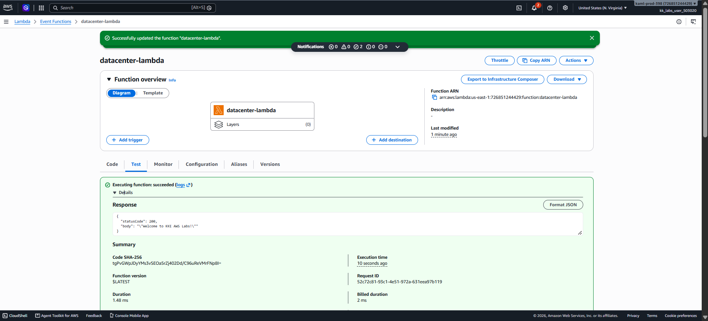
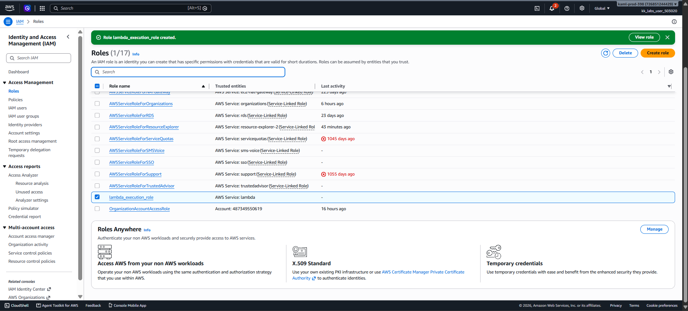

# Day 33 — Create an AWS Lambda Function (Python)

## 🎯 Objective
Create a Lambda function named `datacenter-lambda` using the Python runtime, with an IAM role named `lambda_execution_role`, returning a 200 status code and the body `Welcome to KKE AWS Labs!`.

## 🧭 Steps Taken
1. Created an IAM role `lambda_execution_role` with the `AWSLambdaBasicExecutionRole` policy attached (trusted entity: Lambda).
2. Opened the Lambda Console and clicked **Create function** (Author from scratch).
3. Named the function `datacenter-lambda` and selected the latest Python runtime.
4. Attached the existing `lambda_execution_role` as the execution role.
5. Replaced the default code with a Python handler returning statusCode 200 and the required greeting.
6. Clicked **Deploy** to save the code.
7. Created a test event and ran the function successfully.

## ☁️ AWS Services Used
- **Lambda** (Serverless compute)
- **IAM** (Execution role)

## 💡 Key Learnings
- **Lambda execution roles** require the `AWSLambdaBasicExecutionRole` managed policy to write logs to CloudWatch [citation:6].
- The **handler** function (`lambda_handler`) is the entry point for Python Lambda functions.
- For API Gateway proxy integrations (and general Lambda testing), the response must be a dictionary with `statusCode`, `headers`, and `body` [citation:12].
- **`json.dumps()`** is used to serialize the body string properly so the output is valid JSON.

## 🖼️ Screenshot

### Lambda Test Success

### Lambda Execution Role Created

## 🔗 Reference
- Task provided by: [KodeKloud 100 Days of Cloud](https://kodekloud.com/100-days-of-cloud)
