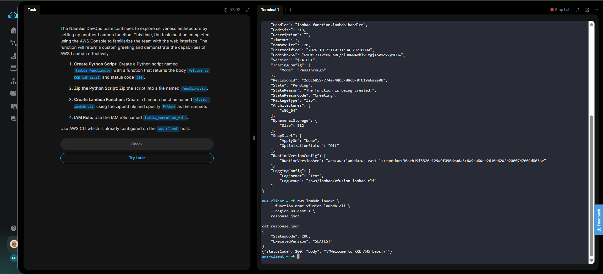

# Day 34 — Create a Lambda Function via AWS CLI

## 🎯 Objective
Create a Python script (`lambda_function.py`) that returns a 200 status code and the body "Welcome to KKE AWS Labs!", zip it into `function.zip`, and deploy it as an AWS Lambda function named `xfusion-lambda-cli` using the AWS CLI and the `lambda_execution_role` IAM role.

## 🧭 Steps Taken
1. Created `lambda_function.py` using the `cat` command.
2. Zipped the script into `function.zip`.
3. Retrieved the ARN for the `lambda_execution_role`.
4. Used `aws lambda create-function` to deploy the function with the Python runtime.
5. Invoked the function via the CLI to verify the output.

## ☁️ AWS Services Used
- **Lambda** (Serverless Compute)
- **IAM** (Execution Role)
- **AWS CLI** (Command Line Interface)

## 💡 Key Learnings
- **Packaging**: Lambda functions must be uploaded as a `.zip` file containing the handler script and any dependencies.
- **Handler Format**: The `--handler` flag uses the format `filename.function_name` (e.g., `lambda_function.lambda_handler`).
- **`fileb://` vs `file://`**: When passing binary files like `.zip` archives to the AWS CLI, you must use `fileb://` (binary base64 encoding). Using `file://` will result in a parsing error.
- **Execution Roles**: The `--role` parameter requires the full ARN of the IAM role, not just the role name.

## 🧾 Commands Used

```bash
cat > lambda_function.py << 'EOF'
import json
def lambda_handler(event, context):
    return {'statusCode': 200, 'body': json.dumps('Welcome to KKE AWS Labs!')}
EOF

zip function.zip lambda_function.py

ROLE_ARN=$(aws iam get-role --role-name lambda_execution_role --query "Role.Arn" --output text)

aws lambda create-function \
    --function-name xfusion-lambda-cli \
    --runtime python3.12 \
    --role $ROLE_ARN \
    --handler lambda_function.lambda_handler \
    --zip-file fileb://function.zip \
    --region us-east-1
```

## 🖼️ Screenshot

### Lambda CLI Deployment



## 🔗 Reference
- Task provided by: [KodeKloud 100 Days of Cloud](https://kodekloud.com/100-days-of-cloud)
